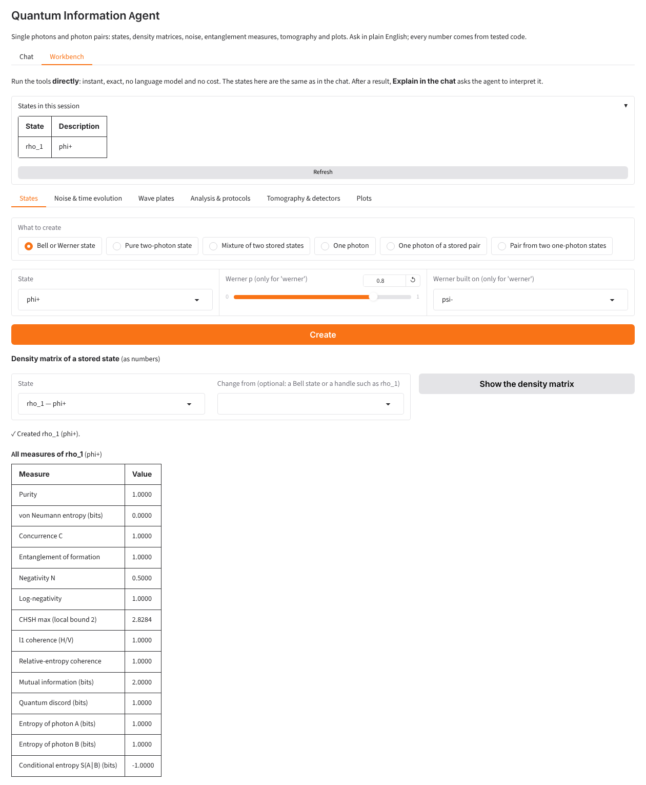
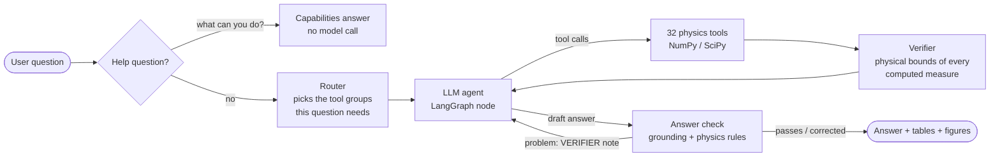
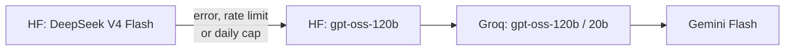
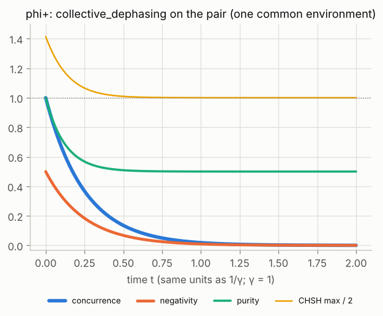
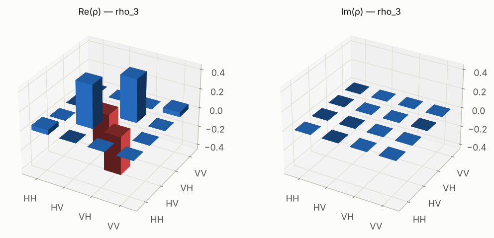

# Quantum Information Agent

[](https://github.com/animeshQKD/quantum-information-agent/actions/workflows/tests.yml)
[](https://huggingface.co/spaces/animesh1986/quantum-information-agent)


[](LICENSE)

An LLM agent for **photonic quantum information**: single photons and polarization-entangled photon
pairs. Ask in plain English, for example *"Apply global depolarizing noise with p = 0.3 to phi+ and
compare it with local depolarizing noise on both photons. Which destroys more entanglement?"* The
agent plans the work, calls **32 tested physics tools**, and answers with tables and figures.

**The language model never computes a number.** Every value comes from NumPy/SciPy code that is
covered by 694 tests and 30 analytic checks. An **answer checker** then compares the model's text
with the tool results and corrects, removes or sends back statements that the results do not support.

**Try it:** [huggingface.co/spaces/animesh1986/quantum-information-agent](https://huggingface.co/spaces/animesh1986/quantum-information-agent)
(chat with the agent, or use the *Workbench* tab: the same tools from panels, without a language model).
**Or call the tools from your own agent:** the Space is also an [MCP server](#use-the-tools-from-your-own-agent-mcp)
for Claude Desktop, Cursor and other MCP clients.



---

## Why this project

LLMs are fluent but unreliable with numbers and with physics that sounds right. For a scientific
assistant, a wrong number stated confidently is worse than no answer. This project explores how to make
an agent **trustworthy in a technical domain**:

1. **Tools do the physics.** The model chooses tools and explains results; it does not calculate.
2. **Answers are checked against the tool results** before the user sees them (see below).
3. **Everything is tested.** Unit tests for the physics, scripted-model tests for the agent loop and
   the checker, and tests that replay real model mistakes found during development.
4. **It runs on free or low-cost models.** Open models through Hugging Face Inference Providers, with
   Groq and Gemini free tiers as automatic fallbacks, and a daily cap on paid calls.

## Architecture



* **Router** (`routing.py`): keyword groups select which tools and which domain rules go into the
  prompt, so each request stays small (important for free-tier token limits).
* **Agent loop** (`graph.py`): a LangGraph `StateGraph` with `agent → tools → verifier → agent`,
  `MemorySaver` for conversation memory, and a per-question cap on model calls.
* **Tools** (`agent_tools.py`, `qi_tools.py`): states, noise channels (local and global Kraus
  operators), Lindblad time evolution, wave plates, maximum-likelihood tomography with bootstrap error
  bars, certification of entanglement / steering / CHSH violation, protocols, plots.
* **Verifier** (`graph.py`): after each tool step, every computed measure is checked against physical
  bounds (purity in [1/4, 1], concurrence in [0, 1], CHSH ≤ 2√2, concurrence and negativity agreeing on
  entanglement); a violation is sent back to the model as a `VERIFIER:` note.
* **Answer check** (`graph.py`): see the next section.
* **Sessions** (`session.py`): every browser tab has its own states, uploads and figures (context
  variables), cleaned up after two hours; numerical work is serialized with a lock because matplotlib
  is not thread-safe.
* **Providers** (`llm.py`): an ordered chain with automatic fallback:



## The answer check

After the model writes its answer, deterministic checks compare it with the tool results of the same
question:

| Check | Example it caught (real model output during development) |
|---|---|
| **Grounding**: every decimal must appear in a tool result or the question | quoted e^(−0.5) = 0.6065 at t = 0.5, a time the tool never sampled → sent back |
| **Table cells** must be the tool's values at their row's parameter | values copied into the wrong row of a time table → sent back |
| **Comparisons** between two states are checked against their measures | "the CHSH maximum is closer to the classical bound 2 for local noise" (local 1.3859, global 1.9799) → removed |
| **Physics rules** for statements that are known to be false | "global depolarizing keeps a Werner state, while local depolarizing mixes in more components" (local noise on a Bell state is also Werner) → removed |
| **Conventions** | "azimuth 0°" for circularly polarized light (undefined) → corrected; a column labelled CHSH/2 holding CHSH values → relabelled; "no Bell violation" when only CHSH was tested → "no CHSH violation" |
| **Completeness** | a state the user asked about was created but never measured → sent back |
| **Parameter binding**: each value in the question must reach the tool on the channel it was given for | asked for global depolarizing with p = 0.3, ran it with p = 0.03 and quoted that result faithfully (every number grounded, wrong experiment) → sent back; if the model ignores the note, the user sees a warning. Suggested by a reviewer on Hugging Face |
| **Self-talk** | "Let me note the actual numbers: …" and replies addressed to the checker → removed |

Corrections are made in place (a re-ask often returns a shorter, worse answer); the user sees a short
note saying what was changed and why, and every deleted sentence is written to `logs/answer_check.log`.

The checker itself is tested against **false positives** found in real runs, for example
"local noise *destroys more* entanglement *than* global" (a true statement that a naive comparison
reads as "more entanglement"), or CHSH = 2.0000 that is really 2.0000137 and therefore still above 2.

## What it computes

| Area | Examples |
|---|---|
| States | Bell and Werner states, any pure state, mixtures, single photons (H, V, D, A, R, L, any ellipse, partial polarization), reduced states, products |
| Measures | concurrence, negativity, log-negativity, entanglement of formation, CHSH (Horodecki), von Neumann / conditional entropy, mutual information, discord, coherence; Stokes parameters for one photon |
| Noise | local channels on one or both photons; global 4×4 channels (depolarizing, dephasing, collective dephasing and decay, correlated flips); your own Kraus operators with a completeness check |
| Time evolution | Lindblad master equation, local Hamiltonians, exact key times (sudden death, halving, CHSH reaching 2), every density-matrix element versus time |
| Optics | half- and quarter-wave plates at any angle, phase compensation |
| Data | maximum-likelihood tomography of measured counts (one or two photons) with bootstrap error bars and a fit check; simulated experiments with detector efficiency, dark counts and accidentals |
| Certification | entanglement, EPR steering and CHSH violation with their statistical significance |
| Protocols | teleportation fidelity, entanglement-based QKD key rate, bit-flip code |

<p align="center">
  
  
</p>

Limits: one or two qubits; Markovian dynamics; asymptotic QKD key rates; simple detector models.
When a task needs a tool the agent does not have, it says so instead of guessing.

## Run it

```bash
git clone https://github.com/animeshQKD/quantum-information-agent.git
cd quantum-information-agent
python -m venv .venv && source .venv/bin/activate      # Windows: .venv\Scripts\activate
pip install -r requirements.txt
cp .env.example .env                                    # Windows: copy .env.example .env
# put at least one key in .env (HF_TOKEN, GROQ_API_KEY or GOOGLE_API_KEY)

python run.py      # chat in the terminal
python app.py      # web app (chat + Workbench) at http://127.0.0.1:7860
```

The Workbench and the MCP server work without any key.

## Use the tools from your own agent (MCP)

The app is also an **MCP server** (`mcp_server.py`): 33 tools, the physics tools for photonic states,
noise, Lindblad evolution, wave plates, tomography, certification, protocols and plots, two session tools,
and `check_answer`, which runs this app's answer checks on another agent's draft. Another agent calls them
directly; no language model runs on this side.

| | Address |
|---|---|
| Hugging Face Space | `https://animesh1986-quantum-information-agent.hf.space/gradio_api/mcp/` |
| Local (`python app.py`) | `http://127.0.0.1:7860/gradio_api/mcp/` |

**Cursor** (`~/.cursor/mcp.json`) and other clients that speak streamable HTTP:

```json
{"mcpServers": {"quantum-information": {"url": "https://animesh1986-quantum-information-agent.hf.space/gradio_api/mcp/"}}}
```

**Claude Desktop / claude.ai:** *Customize → Connectors → Add custom connector*, paste the Space address
above, no sign-in needed. The connector is reached from Anthropic's servers, so this works for the Space,
not for a server on your own computer. For a local server, add a bridge to `claude_desktop_config.json`
instead (needs Node.js for `npx`), then restart Claude Desktop:

```json
{"mcpServers": {"quantum-information-local": {"command": "npx",
  "args": ["mcp-remote", "http://127.0.0.1:7860/gradio_api/mcp/"]}}}
```

How it works:

* **Sessions.** States live on the server and are addressed by handles (`rho_1`, `rho_2`, …). The first
  call opens a session and returns a `session_id`; the client passes it in later calls. Ids are random
  and cannot be chosen, so clients never see each other's states. Sessions end after two hours idle
  (or with `end_session`), and MCP sessions have their own cap, so they cannot push web visitors out.
* **Results** are JSON; plotting tools also return the figure as a PNG image.
* **Your own data:** `reconstruct_state_from_counts` takes the counts as pasted CSV text.
* **Not exposed:** the chat (it spends the model quota) and the Workbench buttons. The Gradio API of the
  app consists of exactly these 33 tools (tested).
* **Limits on the Space:** 120 tool calls per minute for the whole server, bounded sweep sizes, 1 MB of
  CSV text. Work is serialized with the same compute lock as the chat and the Workbench.

`python mcp_client_check.py [URL]` runs a real MCP client against a server (local by default) and checks
43 results: closed-form values, images, separate sessions, refused requests and `check_answer`.

### Which checks apply where

The physics is the same on both sides, but the built-in chat and an outside agent are not checked in the
same way. The answer check in `graph.py` reads the user's question and the model's draft. Over MCP the
server never sees either, unless the client sends them to `check_answer`.

| Check | Built-in chat | MCP client |
|---|---|---|
| Tool schemas: fixed choices, required arguments, types | always | always |
| Tool validation: ranges, ΣK†K = I, unknown handles, CSV checks | always | always |
| Results state what they were computed for ("Created rho_1 (werner, p=0.8)") | always | always |
| The draft quotes only numbers the tools returned | always | with `check_answer` |
| Every value in the question was used (asked p = 0.8, computed p = 0.9) | always | with `check_answer` |
| Noise parameters bound to the right channel | always | with `check_answer` |
| Known false statements corrected ("C = p for a Werner state") | always | with `check_answer` |
| Thinking aloud and retracted drafts removed | always | with `check_answer` |
| Question-dependent checks inside tools (e.g. the Bell state named in the question) | always | no: tools never see the question |

`check_answer` is optional: a client that does not call it, or paraphrases the question, is not checked.
It sees only the calls made to this server in the same session, so stateless tools (`qkd_key_rate`,
`bit_flip_code`, `get_kraus_operators`) take an optional `session_id` for this.

**The same question on both sides.** *"What is the concurrence of a Werner state with p = 0.8?"* The
tools return C = 0.7000, N = 0.3500, purity 0.7300, CHSH max 2.2627.

* **Built-in chat** (a real answer of the Space, 2026-11-06). The model wrote "the concurrence is C = p
  (here 0.8)", then "Let me reconsider. The tool reports concurrence 0.7, not 0.8", then rewrote the
  section. The answer check now removes the retracted section and keeps the rewrite
  (`test_self_correction.py`).
* **An outside agent that sends the same draft to `check_answer`** gets `verdict: problems`,
  `self-correction`, and a `corrected_answer` with the same section removed.
* **An outside agent that silently computed p = 0.9** (example draft: "The concurrence of the Werner state
  with p = 0.8 is 0.85.") gets `verdict: problems`, `parameter`: *the user's request contains the value(s)
  0.8 but no tool call in this turn used it*. Every number in that draft is a correct tool result, so
  only the comparison with the question catches it.
* **An outside agent that does not call `check_answer`** shows the user whatever it writes. The only trace
  of a changed parameter is the client's own record of its tool calls (Claude shows the arguments when it
  asks permission for a call).

These cases are tests in `test_mcp_server.py`.

## Tests

```bash
pytest -q                     # 694 tests, offline: models are scripted, no API key needed
python verify_features.py     # 30 results compared with analytic formulas
```

The tests run on every push (GitHub Actions). They cover the physics (`test_qi_tools.py`,
`test_tomography.py`, …), the agent loop with scripted models (`test_graph_offline.py`), the answer
check (`test_agent_checks.py`, `test_photons_global.py`), the web app and per-user sessions
(`test_app.py`, `test_session.py`), the MCP server (`test_mcp_server.py`) and the deployment
(`test_deploy.py`).

## Deploy to a Hugging Face Space

```bash
hf auth login                 # a token with write access
python deploy_space.py --repo YOUR_HF_NAME/quantum-information-agent --dry-run --settings
python deploy_space.py --repo YOUR_HF_NAME/quantum-information-agent --settings
```

The script uploads a whitelist of files only (never `.env`), scans them for API keys, checks with pip
that the Space can install the pinned packages, writes the Space card, and sends the keys from `.env`
as encrypted Space secrets (never the paid OpenAI key). On the Space, paid OpenAI is switched off, model
calls have a daily cap, and each visitor has an hourly question limit.

## Project structure

| File | Role |
|---|---|
| `qi_tools.py` | the physics: states, channels, measures, Lindblad evolution, tomography |
| `agent_tools.py` | the 32 LangChain tools the agent can call |
| `graph.py` | LangGraph agent loop, verifier and answer check |
| `routing.py` | tool groups and domain rules per question |
| `llm.py` | provider chain, fallbacks, call caps |
| `display.py`, `plots.py` | tables and figures |
| `app.py`, `workbench.py`, `workbench_ui.py` | Gradio web app (chat + Workbench) |
| `mcp_server.py` | the physics tools as an MCP server (served by `app.py`) |
| `session.py` | per-user state for the web app and the MCP server |
| `run.py` | terminal interface |
| `capabilities.py` | "What can you do?" answered without a model |
| `deploy_space.py` | safe deployment to Hugging Face Spaces |
| `benchmark.py`, `check_llms.py`, `hf_models.py` | compare models and providers |
| `verify_features.py`, `test_*.py`, `mcp_client_check.py` | analytic checks, tests, MCP client check |

## Author

**Dr. Animesh Sinha Roy**, physicist (quantum information theory and quantum computation; 13 years of research
on quantum entanglement, decoherence, QKD, polarization-entangled photons, density-matrix reconstruction and
entanglement characterization), building LLM agents.

- GitHub: [animeshQKD](https://github.com/animeshQKD)
- Hugging Face: [animesh1986](https://huggingface.co/animesh1986)

## License

MIT, see [LICENSE](LICENSE).
